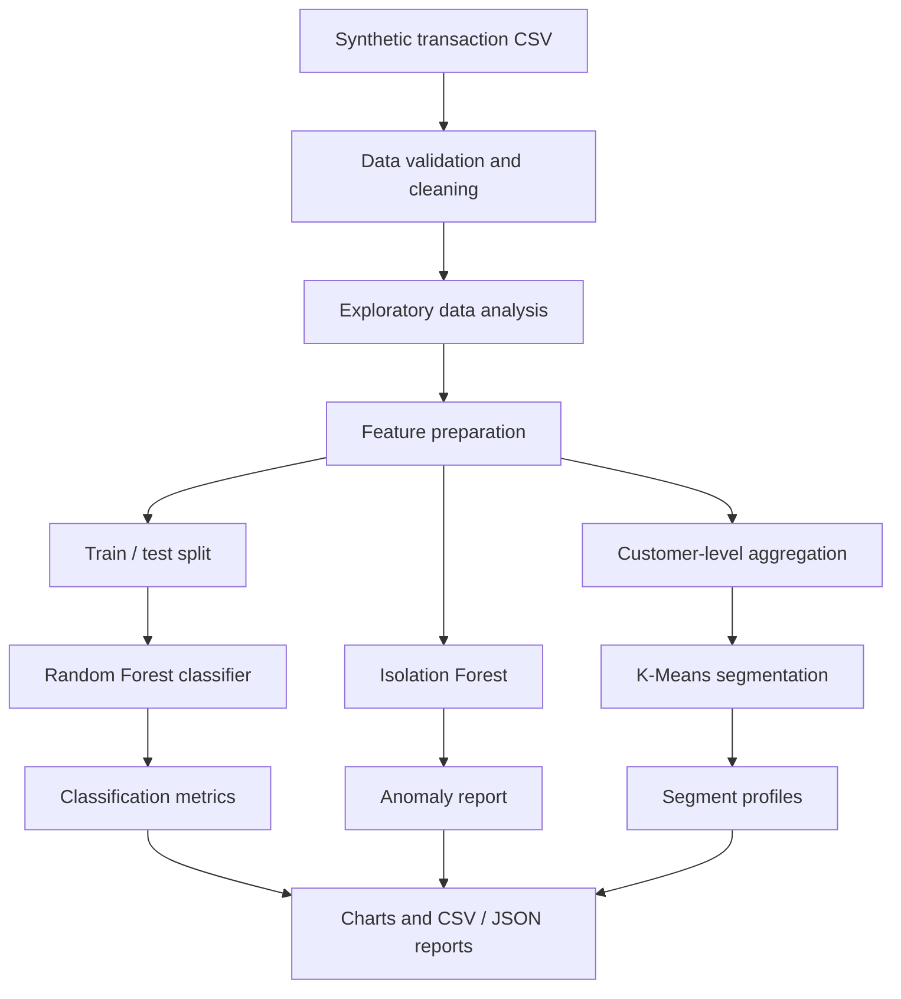

<div align="center">

# FinSight AI

### Financial Transaction Risk & Customer Behavior Analytics

**Turn raw transaction data into measurable risk signals and customer insights.**

<p>
  
  
  
  
  
</p>

[Overview](#overview) · [Visual Gallery](#visual-gallery) · [Pipeline](#how-the-analysis-works) · [Models](#machine-learning-methods) · [Results](#analysis-gallery) · [Run Locally](#getting-started)

</div>

---

## Overview

FinSight AI is a Python-based financial transaction analytics and machine-learning project. It generates **50,000 synthetic payment transactions**, explores transaction behaviour, prepares model-ready features, and applies three complementary analytical methods:

- **Random Forest** — supervised classification of simulated fraud patterns.
- **Isolation Forest** — unsupervised anomaly detection.
- **K-Means** — customer behaviour segmentation using aggregated transaction features.

The project exports analysis charts, model evaluation reports, anomaly rankings, and customer segment profiles.

> **Data and scope:** The included data is synthetic and generated for learning and demonstration. It is not PayPal data, does not represent PayPal's fraud rules, and is not a production fraud detection system. Synthetic labels are based on simulated patterns; results should not be represented as real-world fraud performance.

## Visual Gallery

A curated album of the project concept, analytical workflow, and generated analysis outputs.

<div align="center">

<table>
  <tr>
    <td width="50%">
      
      <p align="center"><b>01 · Analytics dashboard concept</b><br/><sub>Illustrative product UI concept, not a live application screenshot.</sub></p>
    </td>
    <td width="50%">
      
      <p align="center"><b>02 · End-to-end pipeline</b><br/><sub>High-level view of transaction ingestion and analysis stages.</sub></p>
    </td>
  </tr>
  <tr>
    <td width="50%">
      
      <p align="center"><b>03 · Data preparation</b><br/><sub>Cleaning, transforming and preparing transaction features.</sub></p>
    </td>
    <td width="50%">
      
      <p align="center"><b>04 · Model analysis</b><br/><sub>Classification, anomaly detection and customer segmentation.</sub></p>
    </td>
  </tr>
</table>

</div>

## Animated Technology Stack

<div align="center">


**FINSIGHT AI · INDIVIDUAL COMPONENT CONNECTION SEQUENCE**

<sub>Each connection activates in sequence to show the flow from data ingestion to preparation, feature engineering, model analysis and report generation.</sub>

</div>

### Technology responsibilities

| Technology | Role in this project |
|---|---|
| Python | Project implementation and orchestration |
| Pandas | Tabular data cleaning, transformation and aggregation |
| NumPy | Numerical operations and feature calculations |
| Scikit-learn | Preprocessing, classification, anomaly detection, clustering and evaluation |
| Matplotlib | Exploratory analysis and model-result visualizations |

## How the Analysis Works



### 1. Data generation and preparation

- Generates 50,000 synthetic transactions across customers, countries, devices and payment methods.
- Prepares numeric and categorical transaction attributes.
- Keeps the target `is_fraud` out of the model input features.
- Excludes transaction and customer identifiers from supervised model features to reduce identifier memorization.
- Fits preprocessing inside a Scikit-learn Pipeline so transformations learn from the training partition only.

### 2. Exploratory data analysis

- Summarizes transaction volume and amount patterns.
- Compares simulated fraud labels across payment methods and transaction values.
- Exports KPI summaries and visual reports.

### 3. Machine-learning analysis

- Uses a stratified holdout split for the supervised classification task.
- Evaluates the classifier with precision, recall, F1, PR-AUC, ROC-AUC and a confusion matrix.
- Runs Isolation Forest separately from the fraud target.
- Aggregates customer-level behaviour before applying K-Means.

## Machine Learning Methods

| Method | Learning approach | Project purpose | Main output |
|---|---|---|---|
| Random Forest | Supervised | Classify simulated fraud patterns | Predicted class, scores and evaluation metrics |
| Isolation Forest | Unsupervised | Identify unusual transaction behaviour | Anomaly scores and top-anomaly report |
| K-Means | Unsupervised | Group customers by behaviour | Cluster assignments and segment profiles |

### Why use three methods?

- Classification learns from the synthetic target labels.
- Anomaly detection looks for unusual patterns without using those labels during fitting.
- Clustering groups customers based on aggregated behavioural features rather than predicting fraud.

These outputs answer different analytical questions and should be interpreted independently.

## Analysis Gallery

The following plots are generated by the project and stored under `outputs/figures/`.

<div align="center">

<table>
  <tr>
    <td width="50%">
      
      <p align="center"><b>Transaction volume over time</b></p>
    </td>
    <td width="50%">
      
      <p align="center"><b>Feature importance</b></p>
    </td>
  </tr>
  <tr>
    <td width="50%">
      
      <p align="center"><b>Classification confusion matrix</b></p>
    </td>
    <td width="50%">
      
      <p align="center"><b>Precision–recall evaluation</b></p>
    </td>
  </tr>
  <tr>
    <td width="50%">
      
      <p align="center"><b>Customer behaviour segments</b></p>
    </td>
    <td width="50%">
      
      <p align="center"><b>Fraud labels by payment method</b></p>
    </td>
  </tr>
</table>

</div>

## Key Analytical Decisions

- The target `is_fraud` is never included as a model input.
- Transaction IDs and customer IDs are excluded from supervised model features.
- Preprocessing is fitted inside a Scikit-learn Pipeline to avoid fitting transformations on the test partition.
- A stratified holdout split preserves the minority-class proportion.
- Accuracy is not used alone; precision, recall, F1 and PR-AUC are included for the imbalanced classification task.
- Isolation Forest is fitted without using the fraud target.
- K-Means uses customer-level aggregates and scaled features. Cluster numbers are arbitrary labels and must be interpreted using the segment profiles.

## Project Structure

```text
FinSight-AI/
├── data/
│   └── transactions.csv
├── docs/
│   ├── PROJECT_CASE_STUDY.md
│   └── images/
│       ├── dashboard-concept.png
│       ├── pipeline-overview.png
│       ├── data-cleaning-workflow.gif
│       ├── ml-algorithms-workflow.gif
│       └── technology-connection-sequence.gif
├── outputs/
│   ├── figures/
│   └── reports/
├── src/
│   ├── generate_data.py
│   ├── eda.py
│   ├── modeling.py
│   ├── segmentation.py
│   └── run_project.py
├── requirements.txt
└── README.md
```

## Getting Started

### Prerequisites

- Python 3.10 or newer
- Visual Studio Code (recommended)
- Git (optional)

### 1. Clone the repository

```bash
git clone https://github.com/YOUR_USERNAME/FinSight-AI.git
cd FinSight-AI
```

### 2. Create a virtual environment

**Windows PowerShell**
```powershell
python -m venv .venv
.venv\Scripts\Activate.ps1
```

If activation is blocked in PowerShell:
```powershell
Set-ExecutionPolicy -Scope Process -ExecutionPolicy Bypass
.venv\Scripts\Activate.ps1
```

**macOS / Linux**
```bash
python3 -m venv .venv
source .venv/bin/activate
```

### 3. Install dependencies

```bash
python -m pip install --upgrade pip
pip install -r requirements.txt
```

### 4. Run the complete analysis

```bash
python src/run_project.py
```

The first run generates the synthetic transaction dataset and executes the analysis modules. Model training may take a few minutes depending on your machine.

### 5. Review generated outputs

| Output | Location |
|---|---|
| KPI summary | `outputs/reports/kpi_summary.csv` |
| Classification metrics | `outputs/reports/model_metrics.json` |
| Detailed classification report | `outputs/reports/classification_report.json` |
| Anomaly metrics | `outputs/reports/anomaly_metrics.json` |
| Top anomalies | `outputs/reports/top_anomalies.csv` |
| Customer assignments | `outputs/reports/customer_segments.csv` |
| Segment profiles | `outputs/reports/segment_profiles.csv` |
| Country risk summary | `outputs/reports/country_risk_summary.csv` |
| Combined project summary | `outputs/reports/final_project_summary.json` |

### Run individual modules

```bash
python src/generate_data.py
python src/eda.py
python src/modeling.py
python src/segmentation.py
```

## Suggested Interview Discussion

1. Why can accuracy be misleading when fraud is a minority class?
2. What is the difference between classification and anomaly detection?
3. Why should preprocessing be included inside a Scikit-learn Pipeline?
4. Why were transaction and customer identifiers excluded from model features?
5. How does changing the classification threshold affect false positives and false negatives?
6. Why should K-Means clusters be profiled before assigning business meaning?
7. Why can synthetic-data performance not establish real-world fraud detection quality?

## Future Enhancements

- Evaluate on a documented public fraud dataset.
- Add SHAP-based explanations for individual predictions.
- Compare additional classification algorithms.
- Add threshold tuning and cost-sensitive evaluation.
- Build a deployable interactive dashboard.
- Add time-aware validation and drift monitoring.

## Scope and Limitations

FinSight AI is an educational analytics and machine-learning project using generated synthetic transaction data. The labels are simulated, and the resulting metrics do not establish performance on real financial transactions. The dashboard image in the gallery is a concept mockup, not a running application screenshot.

---

<div align="center">

**FINSIGHT AI**

*Explore patterns. Detect anomalies. Understand customer behaviour.*

</div>
